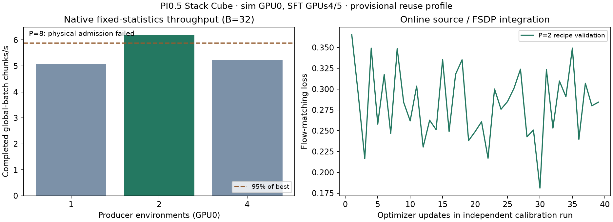
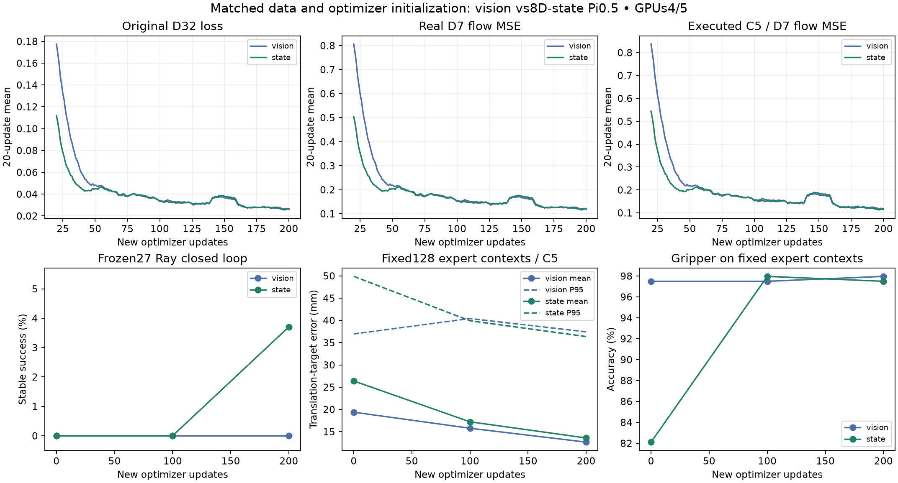
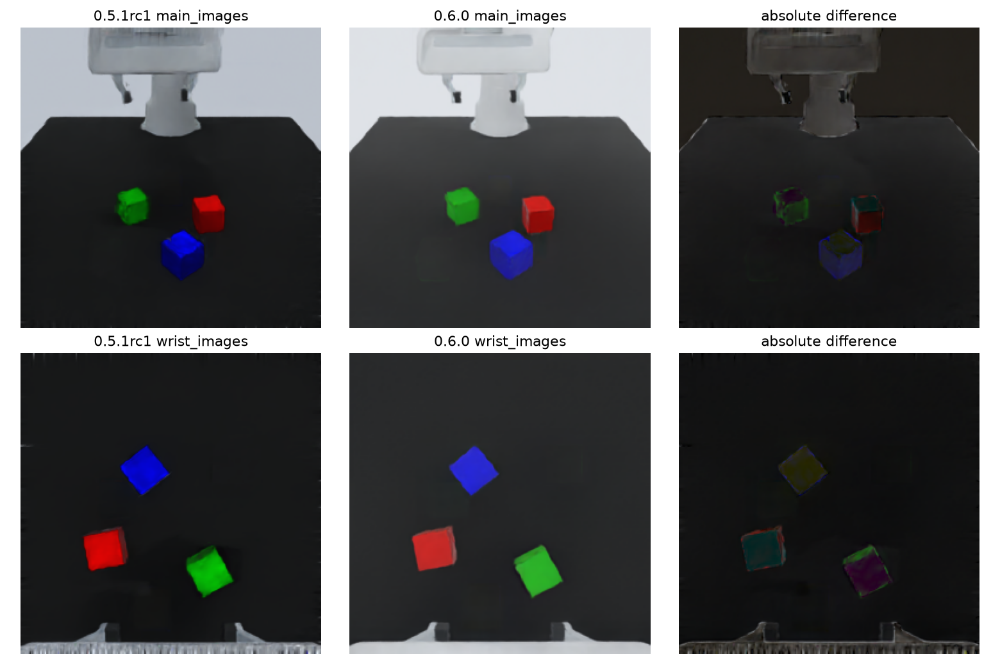

EmbodiChain Stack Cube Experiment Evidence
==========================================

The `immutable evidence archive <https://github.com/yuecideng/RLinf/tree/7d807a5d89d4d1abffd3b4fdfc3481f7c7371d80/examples/embodiment/results/embodichain_stack_cube_pi05>`_ contains the historical requests, normalization statistics, quality reports, curves, and source identities.

The archive retains all 20 original evidence files and their ``SHA256SUMS``. Download the complete directory and run ``sha256sum -c SHA256SUMS`` there to verify it. Runtime configuration, CI, and unit tests do not load these historical experiment outputs; executable reward fixtures remain in ``tests/fixtures/embodichain_stack_cube/``.

Use the archived README to distinguish the original 27-request study from the later 32-request selection cohort. Those measurements retain their original SDK and training sources, do not establish independent test/OOD performance, and do not provide public demonstration data or checkpoints. Generate requests and training-only normalization statistics from the current recipe for new runs.

Native Online SFT Integration (2026-11-06)
-----------------------------------------

The current integration runs Task Program → ODS → a separate data worker →
RLinf Channels → OpenPI transforms → the existing FSDP SFT worker. Physical GPU 0
produces data; GPUs 4/5 train on one node with RTX PRO 5000 72 GB Blackwell cards.
EmbodiChain main c45fee8e5 plus PR #1101 is pinned at af0401eb5.

Eight fixed training requests passed physical admission at 366–442 controls.
Capacity remains 600; admission still requires completion by 450 plus the final
20 stable controls and at least 20 extra settling controls. Motion uses the
same controller with 50 minimum samples and acceleration 2 rad/s².

All concurrency candidates below used the same checkpoint, seed, fixed native
training normalization, cameras, batch 32 and acceptance rules. Throughput
excludes three warmup updates and covers at least one complete subsequent refill.
Each candidate has a thirty-minute total limit including cleanup.

.. list-table:: Completed chunks per second, including supply waits
   :header-rows: 1

   * - Producer environments
     - Chunks/s
     - Post-warmup optimizer updates
     - Result
   * - 1
     - 5.062
     - 54
     - Passed
   * - 2
     - 6.185
     - 36
     - Selected
   * - 4
     - 5.229
     - 50
     - Passed
   * - 8
     - —
     - 0
     - Failed physical admission after three attempts

Two is the smallest passing producer count within 95% of the best throughput.
The SDK recipe uses 10 cache episodes (3.147 GB), 87 delivered chunks per fresh
episode, hard limit 128, and refill threshold 571. Its nominal target is 6.300
chunks/s; measured controlled throughput is 6.185. The reuse profile remains
``qualified=false``. Initial-fill speed alone does not establish this result.

The reference statistics gave zero roll/pitch action range while native expert
targets vary. With the user's approval, statistics were refit once on 2982 valid
Task Program frames from the eight qualified train requests, then held fixed.
Validation requests never fit statistics. The source reports varying targets
against constant statistics as a warning rather than silently changing them.

The selected short run restored full training state at 15000, saved at 15002,
and restored for update 15003 in a fresh source session. Training losses were
0.245610 and 0.285631; resumed loss was 0.317595. All 665 active Adam states reached
15002; two inactive states stayed at zero. Scheduler and RNG storage were verified.
The checkpoint used the earlier measured P2 recipe with the same cache/quota;
the final recheck adjusted only refill 577→571 and rate 6.16→6.30.

Independent standard Ray evaluation used the frozen 27 validation requests for
450 controls each: **0/27 final stable success**. Two new training updates
validate the pipeline, not learned-policy accuracy. The full 15000-step native
online SFT budget was not run. Do not treat these results as a qualified SFT/PPO
handoff or a scientific reuse-profile validation.

The GPU tests also cover two fills/two optimizer updates, checkpoint+resume,
single-rank gradient accumulation, source exhaustion before another backward,
slow consumption and duplicate requests without a second quota charge. Owned
production processes close on normal/error paths; the SDK additionally bounds
cleanup when its logical creator dies.

``ods_online_sft.json`` stores measurements, fingerprints, tests and local
checkpoint/evidence paths. ``ods_recipe_p2.json`` is the measured provisional
recipe; ``ods_train_norm_stats.json`` and ``ods_norm_provenance.json`` identify
the fixed bootstrap statistics. ``ods_sft_calibration.png`` shows native-statistics
throughput and short-run losses. Local evidence paths are recorded in the JSON;
historical trained checkpoint caches were subsequently removed at the user's
request while reports and data were retained.

State Input Validation (2026-11-07)
----------------------------------

The native recipe now uses all eight normalized robot-state values in the
PI0.5 prompt during SFT, evaluation and PPO. ``state_input_pilot.json`` records
a paired 200-update check using identical fresh ODS batches and restored
optimizer/RNG state. The vision control scored 0/27; the state arm scored 1/27.
Decoded action errors use 128 shared training contexts. This single-seed pilot
does not establish convergence or an online/offline throughput comparison.

``native_sft_progress.json`` records the subsequent experiment from PI0.5 base
weights with a fresh optimizer and state enabled in both arms. The offline arm
used 120 qualified native demonstrations (45,168 valid Task Program frames),
with fixed training-only normalization shared by the online arm.
The local experiment harness preserves offline padding masks and uses FP32
master optimizer state; these overrides are recorded separately from the public
recipe.

.. list-table:: Native Offline Validation
   :header-rows: 1

   * - Optimizer updates
     - Final stable success
   * - 0
     - 0/27
   * - 2,500
     - 12/27 (44.44%)
   * - 5,000
     - 17/27 (62.96%)

Collection/export took 2,304.04 seconds; offline training took 16,012.10 seconds
on GPUs 4/5. The ODS arm was paused at update 1,847 with a complete checkpoint,
so its final success and wall-time comparison are unavailable. The requested
budgets differ: offline fixes 120 demonstrations while ODS generates fresh
demonstrations continuously. Both experiments use one seed and 27 frozen
validation requests. Historical pilot checkpoints were removed during the
user-requested cache cleanup; their audit identities remain in the records.

SDK Main and DexSim 0.6 Migration (2026-11-19)
---------------------------------------------

``sdk_main_dexsim060.json`` records installation, CPU and GPU checks for the
official main pin fb96705b0 and DexSim 0.6.0. The training pipeline passes:
two-rank ODS updates, full checkpoint save/resume, single-rank accumulation,
slow consumption and source failure cleanup. The final source schema includes
the installed SDK/DexSim versions; a fresh schema-v2 checkpoint resumes, while
the legacy schema is rejected before delivering any optimizer batch.

Nine source attempts yielded eight qualified demonstrations at 343–417 controls.
The unstable attempt was rejected; capacity 600 and the 450-control/final-20
admission contract are unchanged. This is a source check, not a learned-policy
success rate or a new concurrency benchmark.

The existing native offline step-5000 policy scores 1/27 on the new runtime,
compared with its archived 17/27. At identical 27-row resets, state, joint and
object poses match exactly; front/wrist images differ by 30.29/19.77 pixel levels
on average. The old/new model interpreters produce identical actions on two
fixed contexts with identical noise. These checks demonstrate an RGB shift;
they do not exclude dynamic physics differences. Recollect new-runtime images,
recalibrate supply throughput and requalify the policy before PPO.

