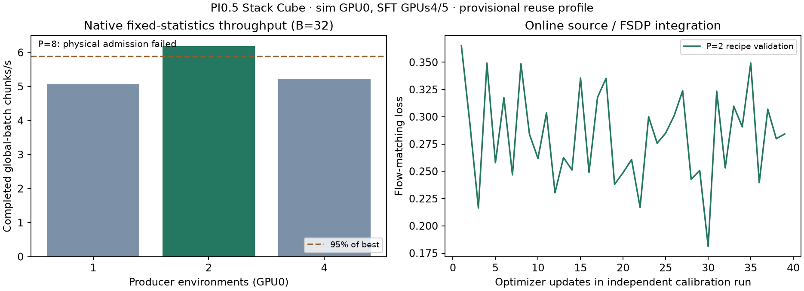

EmbodiChain Stack Cube Experiment Evidence
==========================================

The `immutable evidence archive <https://github.com/yuecideng/RLinf/tree/7d807a5d89d4d1abffd3b4fdfc3481f7c7371d80/examples/embodiment/results/embodichain_stack_cube_pi05>`_ contains the historical requests, normalization statistics, quality reports, curves, and source identities.

The archive retains all 20 original evidence files and their ``SHA256SUMS``. Download the complete directory and run ``sha256sum -c SHA256SUMS`` there to verify it. Runtime configuration, CI, and unit tests do not load these historical experiment outputs; executable reward fixtures remain in ``tests/fixtures/embodichain_stack_cube/``.

Use the archived README to distinguish the original 27-request study from the later 32-request selection cohort. Those measurements retain their original SDK and training sources, do not establish independent test/OOD performance, and do not provide public demonstration data or checkpoints. Generate requests and training-only normalization statistics from the current recipe for new runs.

Native Online SFT Integration (2026-11-06)
-----------------------------------------

The current integration runs Task Program → ODS → a separate data worker →
RLinf Channels → OpenPI transforms → the existing FSDP SFT worker. Physical GPU 0
produces data; GPUs 4/5 train on one node with RTX PRO 5000 72 GB Blackwell cards.
EmbodiChain main c45fee8e5 plus PR #1101 is pinned at af0401eb5.

Eight fixed training requests passed physical admission at 366–442 controls.
Capacity remains 600; admission still requires completion by 450 plus the final
20 stable controls and at least 20 extra settling controls. Motion uses the
same controller with 50 minimum samples and acceleration 2 rad/s².

All concurrency candidates below used the same checkpoint, seed, fixed native
training normalization, cameras, batch 32 and acceptance rules. Throughput
excludes three warmup updates and covers at least one complete subsequent refill.
Each candidate has a thirty-minute total limit including cleanup.

.. list-table:: Completed chunks per second, including supply waits
   :header-rows: 1

   * - Producer environments
     - Chunks/s
     - Post-warmup optimizer updates
     - Result
   * - 1
     - 5.062
     - 54
     - Passed
   * - 2
     - 6.185
     - 36
     - Selected
   * - 4
     - 5.229
     - 50
     - Passed
   * - 8
     - —
     - 0
     - Failed physical admission after three attempts

Two is the smallest passing producer count within 95% of the best throughput.
The SDK recipe uses 10 cache episodes (3.147 GB), 87 delivered chunks per fresh
episode, hard limit 128, and refill threshold 571. Its nominal target is 6.300
chunks/s; measured controlled throughput is 6.185. The reuse profile remains
``qualified=false``. Initial-fill speed alone does not establish this result.

The reference statistics gave zero roll/pitch action range while native expert
targets vary. With the user's approval, statistics were refit once on 2982 valid
Task Program frames from the eight qualified train requests, then held fixed.
Validation requests never fit statistics. The source reports varying targets
against constant statistics as a warning rather than silently changing them.

The selected short run restored full training state at 15000, saved at 15002,
and restored for update 15003 in a fresh source session. Training losses were
0.245610 and 0.285631; resumed loss was 0.317595. All 665 active Adam states reached
15002; two inactive states stayed at zero. Scheduler and RNG storage were verified.
The checkpoint used the earlier measured P2 recipe with the same cache/quota;
the final recheck adjusted only refill 577→571 and rate 6.16→6.30.

Independent standard Ray evaluation used the frozen 27 validation requests for
450 controls each: **0/27 final stable success**. Two new training updates
validate the pipeline, not learned-policy accuracy. The full 15000-step native
online SFT budget was not run. Do not treat these results as a qualified SFT/PPO
handoff or a scientific reuse-profile validation.

The GPU tests also cover two fills/two optimizer updates, checkpoint+resume,
single-rank gradient accumulation, source exhaustion before another backward,
slow consumption and duplicate requests without a second quota charge. Owned
production processes close on normal/error paths; the SDK additionally bounds
cleanup when its logical creator dies.

``ods_online_sft.json`` stores measurements, fingerprints, tests and local
checkpoint/evidence paths. ``ods_recipe_p2.json`` is the measured provisional
recipe; ``ods_train_norm_stats.json`` and ``ods_norm_provenance.json`` identify
the fixed bootstrap statistics. ``ods_sft_calibration.png`` shows native-statistics
throughput and short-run losses. The checkpoint and evaluation videos remain
under the local evidence directory recorded in the JSON.
